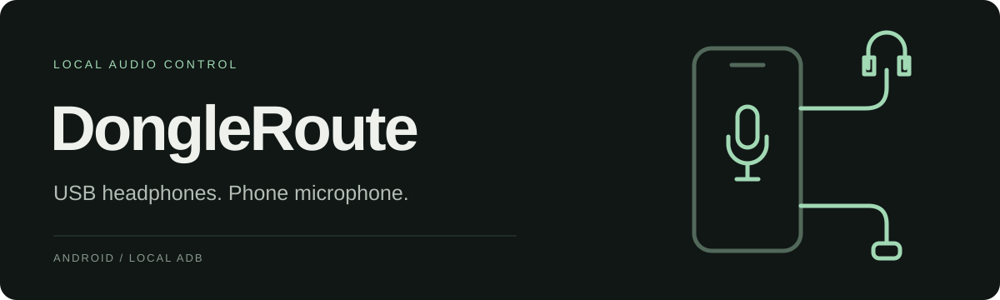
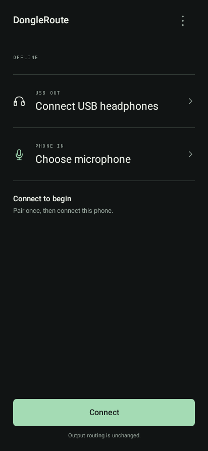
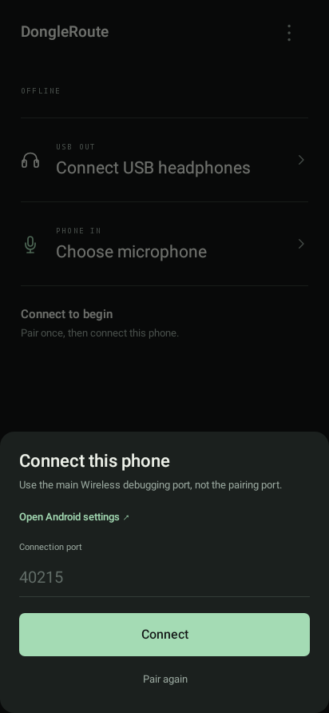

<p align="center"></p>
<p align="center">
  <a href="https://github.com/nyxbydesign/dongle-route/releases"></a>
  
  
</p>

Some USB audio dongles advertise a microphone input even when you only use their headphone output. **DongleRoute** keeps USB headphones selected while preferring a built-in phone microphone.

One screen. Your dongle, your microphone, and a routing control. Local Wireless ADB is built in.

<p align="center">
  
  
</p>
<p align="center"><sub>Android views rendered with sample inventory.</sub></p>

## Get started

**[Download the APK](https://github.com/nyxbydesign/dongle-route/releases)** · Android 14+ · ARM64 or x86_64

1. Connect your USB headphones. Clear device choices are selected automatically.
2. Open **Connect**. Pair with Android Wireless debugging using split-screen, then enter the connection port from its main Settings page. Returning users can connect with their saved identity.
3. Tap **Use phone mic**. The visible notification keeps the local session available when you leave the app.

The pairing port and connection port are different. Wireless debugging usually requires Wi-Fi. [Setup and recovery](docs/AUTOMATION.md) covers the details.

## Everyday controls

| Control | Result |
| --- | --- |
| **Use phone mic** | Prefers your chosen microphone for normal and communication recording sources. |
| **Stop & restore** | Restores the previous input preferences and keeps local control connected. |
| **Disconnect** | Restores owned preferences when possible, then closes local control. |
| **Android defaults** | Explicitly clears matching phone-microphone preferences. |

Changes wait during calls, recordings and USB enumeration. Reconnecting the selected dongle restores and reapplies the saved route when the local session is available.

## Compatibility and privacy

0.10 was reported working on the user's Pixel 8 Pro running Android 17. This remains a diagnostic release: phone policies and calling apps differ, and a saved preference alone does not prove which microphone an app uses.

The app pairs its own private identity and connects only to localhost. Pairing codes are transient. It leaves output policy and Android security settings alone, and requires no recording permission. Pairing and recovery state survive app updates.

If authorization or connectivity is lost, reconnect with the same identity and restore. Avoid clearing app data or uninstalling while recovery is pending.

## Development

Use JDK 21 and Android SDK / build-tools 35:

```powershell
.\gradlew.bat --no-daemon --max-workers=2 assembleDebug assembleDebugAndroidTest lintDebug
```

APK: `app/build/outputs/apk/debug/app-debug.apk`. Releases retain the existing development signer for updates.

[Contributing](CONTRIBUTING.md) · [Architecture](docs/ARCHITECTURE.md) · [Third-party notices and relinking](docs/THIRD-PARTY.md)
